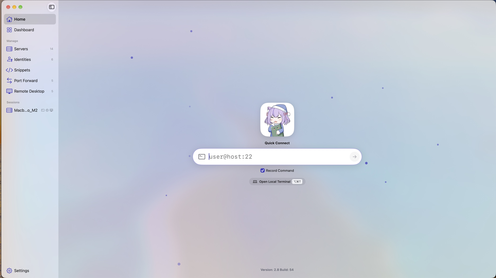
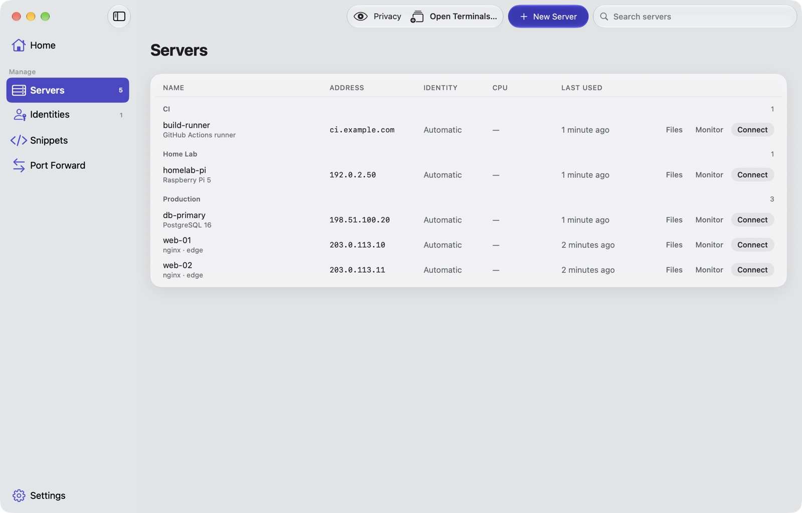
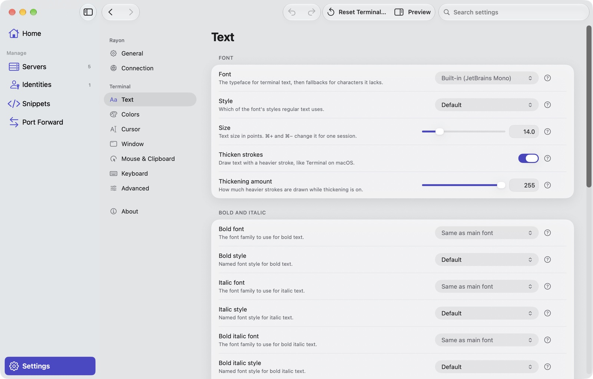
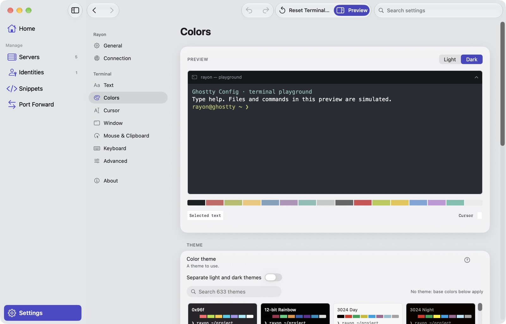
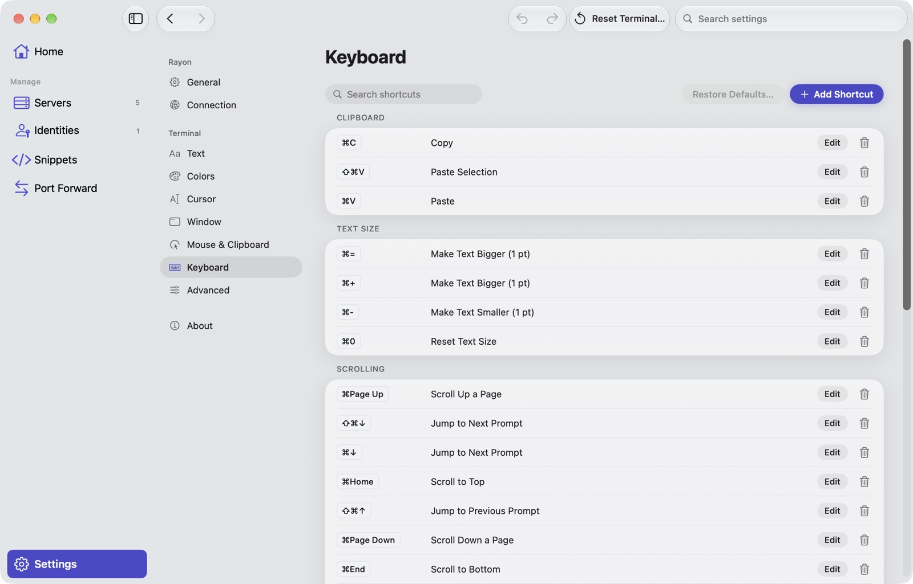

<p align="center">
  
</p>

# Rayon

**English** · [简体中文](./README.zh-Hans.md) · [繁體中文](./README.zh-Hant.md)

A native macOS app for the Linux and macOS servers you look after: an SSH terminal
built on [Ghostty](https://ghostty.org), SFTP file transfer and a live resource
monitor, side by side for every server.

[](./LICENSE)


<picture>
  <source media="(prefers-color-scheme: dark)" srcset="./Resources/Screenshots/home-dark.jpg">
  
</picture>

## Install

```sh
brew install --cask mizorewww/tap/rayon
```

Requires macOS 13 or later. The app is universal, signed and notarized. You can also
download the disk image from [Releases](https://github.com/mizorewww/Rayon/releases).

## Features

- **Terminal, Files and Monitor for every server**, one click each, with a toolbar
  switcher between them.
- **A native Ghostty terminal**: GPU rendering, 600+ themes, translucent background.
- **Visual terminal settings**: installed fonts with their real styles, recorded
  keyboard shortcuts, a live color preview.
- **Quick Connect**: type `user@host:port` and press Return.
- **Cloudflare Access**: reach servers behind a Cloudflare Tunnel, as
  `ssh -o ProxyCommand='cloudflared access ssh --hostname %h'` does, without
  installing cloudflared. Service tokens are supported.
- **Server monitor** for Linux and macOS: CPU, memory, disks, network and NVIDIA GPUs,
  using native system tools with no agent to install.
- **Identities** (passwords or keys) shared across servers, **snippets** run on many
  servers at once, **port forwarding**, and a **menu bar** monitor.
- An iPhone and iPad app with the same terminal and settings, built from source.

## Screenshots

### Servers

<picture>
  <source media="(prefers-color-scheme: dark)" srcset="./Resources/Screenshots/servers-dark.jpg">
  
</picture>

### Terminal text settings

<picture>
  <source media="(prefers-color-scheme: dark)" srcset="./Resources/Screenshots/text-dark.jpg">
  
</picture>

### Colors with live preview

<picture>
  <source media="(prefers-color-scheme: dark)" srcset="./Resources/Screenshots/colors-dark.jpg">
  
</picture>

### Keyboard shortcuts

<picture>
  <source media="(prefers-color-scheme: dark)" srcset="./Resources/Screenshots/keyboard-dark.jpg">
  
</picture>

## Using Rayon

1. **Add a server**: **New Server** on Dashboard (⇧⌘N).
2. **Connect**: click a server's tile on Dashboard. **Files** opens SFTP and **Monitor** opens live
   usage; the toolbar switcher moves between the three.
3. **Quick Connect**: type `user@host`, `user@host:2222`, a saved server's name or a full
   `ssh` command on Home.
4. **Settings** (⌘,) cover the app and the terminal. Ghostty coverage is described in
   [CONFIGURATION.md](Foundation/RayonTerminal/CONFIGURATION.md).

## Privacy

Your servers, keys, passwords, snippets, files and terminal sessions never leave your devices, except through iCloud Sync into your own iCloud account when you turn it on.

Unlike its sister app FlowDown, which collects nothing, Rayon can send anonymous diagnostics so that its developers can fix crashes. You choose how much in Settings › About › Diagnostics & Usage, on each device:

- **Off:** nothing is sent.
- **Crash reports:** scrubbed crash and hang reports from Apple's MetricKit.
- **Crash reports and usage:** also one daily report of feature counts, rounded into ranges.
- **Detailed:** also performance timings and protocol details, on about one day in ten.

Reports carry no identifier, and the server never stores IP addresses. Server addresses, usernames, keys, commands, files and terminal content are never sent at any level. The default is crash reports and usage, with a notice at first launch. In the EEA, the UK and Switzerland nothing is sent until you choose. "View What's Sent…" shows every report before it goes. The Mac app contacts GitHub only when you choose Check for Updates.

The [privacy policy](Resources/AppStore/PrivacyPolicy) has the details. The report schema is in [`Foundation/Telemetry`](Foundation/Telemetry), the server in [`Server/Telemetry`](Server/Telemetry), and the design in [`docs/telemetry.md`](docs/telemetry.md).

## Build from source

Needs Xcode 26 or later (Swift 6.2).

```sh
git clone https://github.com/mizorewww/Rayon.git
cd Rayon
bash Workflow/Scripts/install-macos.sh   # Release build, installed to /Applications
```

Or open `App.xcworkspace` and run the **Rayon** scheme on a Mac or an iOS 18+ destination.

Signing for iCloud sync, and the CloudKit schema step before a release, are in
[docs/icloud-sync.md](docs/icloud-sync.md).

## Contributing

Bugs and ideas go to [issues](https://github.com/mizorewww/Rayon/issues). Pull
requests are welcome; run the terminal tests first:

```sh
swift test --package-path Foundation/RayonTerminal
```

## License

[MIT](./LICENSE). Third-party licenses are listed in [Resources/LICENSE](./Resources/LICENSE).
